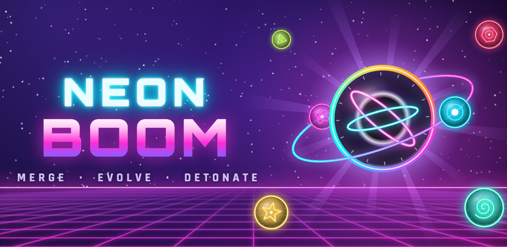

# NEON BOOM

A neon physics merge puzzle for Android. Drop energy cores into the reactor; two identical cores fuse into the next one.
Eleven cores, from **Spark** to **Singularity**. Fuse two Singularities to set off a **NEON BOOM**.

Built with HTML5 + JavaScript + Matter.js (physics), packaged for Android with Capacitor 8 (target API 36), and monetised with Google AdMob.

<p align="center"></p>

## Quick start (Windows)

| Double-click | What it does |
|---|---|
| `0-play-in-browser.bat` | Plays the game in your browser. No install needed |
| `1-setup.bat` | One time: installs everything and opens the Android project in Android Studio |
| `2-sync.bat` | After any change to the game or to the ad IDs |
| `3-build-release.bat` | Builds the signed `.aab` for Google Play (and an `.apk` for direct install) |

On macOS / Linux: `npm run setup`, `npm run sync`, `npm run release`, `npm run doctor`.

**Publishing on Google Play, click by click: [PLAY_STORE.md](PLAY_STORE.md).** All listing texts and form answers: [store/LISTING.md](store/LISTING.md).

## Build steps

| Step | What | Status |
|---|---|---|
| 1 | The game: neon design, physics, particles, synthesised sound and music, autosave, Neon League (AI rivals), touch controls | **done** |
| 2 | Events: Gold Fever (x2 points for 2 min), daily challenges, daily wheel, weekly event bar | next |
| 3 | Ad-to-Win shop: Hammer, Bomb, Evolve, 15-minute VIP mode (uses `NB.ads.rewarded()`, already built) | next |
| 4 | AdMob: banner, interstitial every 2 runs, rewarded Continue at game over, Google consent form | **done** |
| 5 | Android project: `package.json`, `capacitor.config.json`, one-click Windows scripts, signed release builds | **done** |
| 6 | Google Play: icon, feature graphic, 5 screenshots, privacy policy, listing texts | **done** |

## Where things are

```
www/                   the whole game (Capacitor packages this folder)
  index.html           the screens
  css/style.css        the look: colours, buttons, panels, animations
  js/config.js         every game number (sizes, points, timings), easy to tune
  js/ads-config.js     >>> your AdMob IDs and ad settings: the only file to edit for ads <<<
  js/ads.js            banner, interstitial, rewarded ads, consent (simulated in a browser)
  js/native.js         bridge to Android: back button, vibration, splash, links
  js/game.js           the reactor: physics, merging, overload rule, Continue, autosave
  js/render.js         the 11 cores, drawn entirely by code (no image files)
  js/fx.js             particles, shockwaves, flashes, screen shake
  js/audio.js          all sounds and the soundtrack, generated live (no audio files)
  js/league.js         the weekly Neon League against AI rivals
  js/ui.js             menus, score display, toasts, settings
  js/main.js           start-up and the flow between screens
  js/vendor/           Matter.js 0.20.0 (physics), Capacitor 8 runtime
  fonts/               Orbitron + Rajdhani (bundled so the app works offline)
android/               the Android Studio project (generated by Capacitor, patched by tools/android.mjs)
tools/android.mjs      setup · sync · release · doctor (what the .bat files run)
tools/brand/           draws the icons, store screenshots and feature graphic (node tools/brand/build.mjs)
assets/                generated app icons, copied into android/ on every sync
store/                 Google Play graphics + LISTING.md
docs/                  website + privacy policy, served by GitHub Pages
```

## Ads in one minute

- Ads use Google's **test IDs** until you paste yours in `www/js/ads-config.js`. Keep `TEST_MODE: true` while testing.
- Banner: always at the bottom, in its own reserved strip, so it never covers the game.
- Interstitial: once every 2 finished runs, never in the first minute, skipped after a rewarded ad.
- Rewarded: **Continue** at game over (once per run) clears the top of the reactor.
- Consent: Google's UMP form in the EEA, UK and US states. "Privacy & ad choices" appears in Settings when required.

## Signing keys

`3-build-release.bat` creates `keys/neonboom-upload.jks` the first time. **Back up the `keys` folder.** Git never stores it (`.gitignore`).
